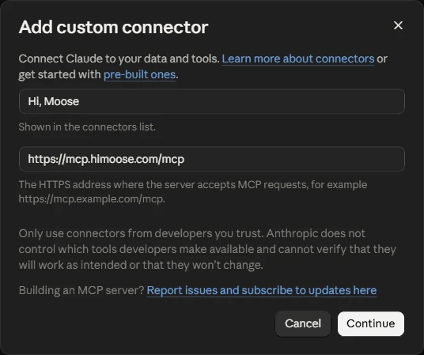

!!! note "Maschinell übersetzt"
    Diese Seite wurde von einer KI übersetzt. Maßgeblich ist die englische Fassung.

    [Auf Englisch lesen](https://himoose.com/docs/integrations/hi-moose-mcp/)

# Hi, Moose MCP

## Wofür das gut ist

Überblick, Werkzeugliste und Fragen und Antworten: [himoose.com/hi-moose-mcp](https://himoose.com/de/hi-moose-mcp/). Diese Seite ist die Einrichtungsanleitung. Die [Werkzeug-Referenz](hi-moose-mcp/tools.md) beschreibt jedes Werkzeug mit dem, was es braucht und was zurückkommt, und die [Fehlerbehebung](hi-moose-mcp/troubleshooting.md) behandelt das Host-Gerät, wartende Aufträge und Verbindungsprobleme. [Sicherheit und Datenverarbeitung](hi-moose-mcp/security.md) beantwortet die Fragen, die eine Sicherheitsprüfung stellt, bevor ein Team sich verbindet.

Mit Hi, Moose MCP können die KI-Apps, in denen Sie schon arbeiten, Hi, Moose nutzen. Fügen Sie es als MCP-Connector in Claude, ChatGPT oder jeder anderen App hinzu, die MCP mit Anmeldung unterstützt, melden Sie sich mit Ihrem Hi, Moose-Konto an und fordern Sie Hi, Moose-Arbeit direkt aus dieser App an. MCP (Model Context Protocol) ist der Standard, über den diese Apps externe Werkzeuge anbinden.

Die Arbeit läuft auf einem Ihrer eigenen Geräte, dem **Host-Gerät**, auf dem Hi, Moose geöffnet und angemeldet bleibt. Ergebnisse gehen an die App zurück und werden in Ihrer [Library](../library/overview.md) gespeichert.

## Was eine verbundene App kann

Mit den aktuellen Werkzeugen kann eine verbundene App:

- Ihre Hi, Moose-Projekte auflisten
- Die in Ihrer Library gespeicherten Briefings und Entwürfe auflisten
- Prüfen, ob Ihre Website ein Thema schon abdeckt, mit den passenden Seiten und dem Datum des geprüften Crawls
- Ein Content-Briefing erstellen
- Einen Entwurf aus einem Briefing schreiben
- Bestehende Inhalte aktualisieren: eine veröffentlichte Seite, einen gespeicherten Entwurf oder eingefügten Text mit den aktuellen Suchergebnissen vergleichen und ein Aktualisierungs-Briefing mit den Lücken sowie einen überarbeiteten Entwurf erhalten
- Ein Beitragsbild erstellen
- FAQs mit FAQPage-Schema für einen gespeicherten Entwurf oder eine Seite Ihrer Website schreiben
- Kernaussagen für einen gespeicherten Entwurf oder eine Seite Ihrer Website schreiben
- Ein AEO-Audit für eine Live-Seite, einen gespeicherten Entwurf oder eingefügten Text ausführen, mit Bewertungen, Problemen und Korrekturvorschlägen
- Interne Links für eine Seite, einen gespeicherten Entwurf oder eingefügten Text planen: auf welche gecrawlten Seiten sie verlinken sollte, mit Ankertext, und welche Seiten auf sie verlinken sollten
- Die Frage „Erscheinen wir in der KI-Suche zu diesem Thema?“ aus den gespeicherten Sichtbarkeitsergebnissen beantworten: je Engine, ob Ihre Marke im letzten Lauf und davor erwähnt oder zitiert wurde, mit einem kurzen Auszug aus der letzten Antwort
- Den vollständigen Text einer gespeicherten KI-Suchantwort lesen
- Die Chancen auflisten, an denen sich Arbeit lohnt, dieselben priorisierten Zeilen wie der Tab Chancen: die genaue Lücke, der nächste Schritt, die Priorität und die Belege, auf Wunsch mit allen Details zu einer Zeile
- Eine veröffentlichte Seite, einen gespeicherten Entwurf oder eingefügten Text in eine Audio-Episode „Diesen Artikel anhören“ verwandeln, mit dem einbettbaren Player-Snippet für die Seite; Stimmen, Länge, Sprache und das Aussehen des Players lassen sich auf der [Audio-Einstellungsseite](https://himoose.com/de/hi-moose-mcp/audio/) wählen und als eine Einstellungszeile in den Chat einfügen
- Den Player einer vorhandenen Audio-Episode neu gestalten, ohne das Audio neu zu rendern
- Fertige Arbeit abholen

Sie kann keine Einstellungen oder Teammitglieder ändern und nichts löschen. Weitere Werkzeuge folgen.

## Bevor Sie beginnen

1. Öffnen Sie Hi, Moose auf dem Gerät, das die Arbeit ausführen soll, und melden Sie sich an.
2. Gehen Sie zu **Einstellungen → Hi, Moose MCP** und wählen Sie dieses Gerät als Host-Gerät für das Projekt. Nur der Kontoinhaber kann das Host-Gerät wählen.
3. Kopieren Sie die dort angezeigte Serveradresse:

```text
https://mcp.himoose.com/mcp
```

## In Claude verbinden

Dieser Abschnitt gilt für Claude.ai im Browser und die Claude-Desktop-App. Claude Code, das Terminal-Werkzeug, hat unten einen eigenen Abschnitt.

1. Öffnen Sie **Einstellungen → Connectors** (auch erreichbar unter claude.ai/customize/connectors).
2. Wählen Sie **Benutzerdefinierten Connector hinzufügen**. Geben Sie einen Namen ein, der in Ihrer Connector-Liste erscheint, zum Beispiel `Hi, Moose`, fügen Sie die Serveradresse ein und klicken Sie auf **Weiter**.

    ```text
    https://mcp.himoose.com/mcp
    ```

    

3. Behalten Sie auf dem nächsten Bildschirm die von Claude erkannten Einstellungen bei: **Jetzt anmelden** unter Authentifizierung und **Veröffentlichte Identität von Claude verwenden** unter OAuth-Client. Fügen Sie keine Request-Header hinzu. Lassen Sie unter Erweitert den Transport auf automatisch; der Server verwendet Streamable HTTP. Klicken Sie auf **Hinzufügen**.

4. Klicken Sie neben Hi, Moose MCP auf **Verbinden**. Eine Hi, Moose-Seite öffnet sich, zeigt, was die App können wird, und bittet Sie, sich mit Ihrem Hi, Moose-Konto anzumelden.
5. Starten Sie einen neuen Chat und fragen Sie zum Beispiel: „Liste meine Hi, Moose-Projekte auf“.

In Team- und Enterprise-Plänen fügt zuerst ein Owner den Connector für die Organisation hinzu, danach verbindet sich jedes Mitglied einzeln.

## In Claude Code verbinden

Claude Code ist Anthropics Kommandozeilen-Werkzeug für Entwickler. Wenn Sie stattdessen Claude.ai oder die Claude-Desktop-App verwenden, nutzen Sie den Abschnitt oben. Führen Sie dies in einem Terminal aus:

```text
claude mcp add --transport http himoose https://mcp.himoose.com/mcp
```

Führen Sie dann in Claude Code `/mcp` aus und folgen Sie der Anmeldung.

## In ChatGPT verbinden

ChatGPT unterstützt eigene MCP-Server in den Bezahlplänen. Die Menünamen ändern sich gelegentlich; das ist der aktuelle Weg.

1. Öffnen Sie **Einstellungen → Apps** (in manchen Versionen **Connectors**). In Business- und Enterprise-Workspaces muss ein Owner eigene Connectors eventuell zuerst erlauben.
2. Wählen Sie **Hinzufügen** und dann **Eigenen MCP-Server erstellen**. Ältere Versionen zeigen stattdessen **MCP-App erstellen** und brauchen vorher eventuell den **Entwicklermodus** in den erweiterten Einstellungen.
3. Fügen Sie die Serveradresse ein, wählen Sie **OAuth** als Authentifizierung und speichern Sie.

    ```text
    https://mcp.himoose.com/mcp
    ```

4. Melden Sie sich auf der Seite, die sich öffnet, mit Ihrem Hi, Moose-Konto an.
5. Schalten Sie den Connector in einem Chat für dieses Gespräch ein und fordern Sie Hi, Moose-Arbeit an.

## Andere Apps

Jede App, die einen entfernten MCP-Server mit OAuth-Anmeldung hinzufügen kann, funktioniert genauso: Serveradresse hinzufügen, mit dem Hi, Moose-Konto anmelden, loslegen.

```text
https://mcp.himoose.com/mcp
```

## Skills für Claude und ChatGPT

Hi, Moose veröffentlicht auf GitHub kostenlose Open-Source-Skills für Answer Engine Optimization (AEO), auch GEO oder AI SEO genannt: [himoose/aeo-skills](https://github.com/himoose/aeo-skills) (MIT-Lizenz). Ein Skill ist ein Ordner mit Anweisungen, denen Ihre KI-App bei einer bestimmten Art von Aufgabe folgt; diese Skills nutzen das offene Format [Agent Skills](https://agentskills.io).

Der erste Skill, `ai-visibility`, liest über Hi, Moose MCP die KI-Suchergebnisse, die Hi, Moose bereits gespeichert hat. Er startet nie neue Prüfungen, ändert keine Einstellungen und veröffentlicht nichts. Fragen Sie zum Beispiel:

- „Erstelle mein Dashboard zur Sichtbarkeit in der KI-Suche.“ Das ist die Standardausgabe: ein interaktives Dashboard auf einer einzigen HTML-Seite. Wählen Sie 7, 30 oder 90 Tage oder eigene Daten, filtern Sie nach KI-Engine, fahren Sie mit der Maus über ein Diagramm, um die Zahlen zu sehen, vergleichen Sie Ihre beobachtete Marke mit Wettbewerbern, sehen Sie die Antworten, in denen Ihre Marke fehlte, und arbeiten Sie eine To-do-Liste mit Schaltflächen **Open in Hi, Moose** ab. Diagramme lassen sich als PNG speichern, die Zahlen als CSV und die Seite als PDF.
- „Schreibe meinen Bericht zur Sichtbarkeit in der KI-Suche als Text für eine E-Mail.“ Sie erhalten einen kurzen schriftlichen Bericht.
- „Woran sollte ich diese Woche arbeiten, um in der KI-Suche häufiger zu erscheinen?“ Sie erhalten Ihre offenen Korrekturen als priorisierte To-do-Liste.

Der Skill funktioniert in jedem Plan. Bewertungen zu Stimmung, Narrativ und Funktionsgenauigkeit gehören zu den Bezahlplänen; Erwähnungen, Zitierungen, Rang und Wettbewerber funktionieren in jedem Plan. Wie bei jedem Werkzeug von Hi, Moose MCP muss Hi, Moose auf dem Host-Gerät geöffnet bleiben, während Sie fragen.

### Den Skill in Claude.ai oder der Claude-Desktop-App hinzufügen

1. Klicken Sie auf der [GitHub-Seite](https://github.com/himoose/aeo-skills) auf **Code → Download ZIP** und entpacken Sie die Datei.
2. Öffnen Sie den Ordner `skills` und packen Sie nur den Ordner `ai-visibility` in eine ZIP-Datei, sodass Sie `ai-visibility.zip` mit dem Ordner `ai-visibility` darin haben.
3. Gehen Sie in Claude zu **Customize → Skills**, klicken Sie auf **+**, dann auf **Create skill → Upload a skill**, und wählen Sie `ai-visibility.zip`.
4. Prüfen Sie, dass **code execution** in den Einstellungen von Claude eingeschaltet ist; Skills brauchen das.
5. Starten Sie einen neuen Chat, prüfen Sie, dass der Hi, Moose-Connector dort eingeschaltet ist, und stellen Sie Ihre Frage.

### Den Skill in Claude Code hinzufügen

Das Repository ist auch ein Claude Code-Plugin. Eine einzige Installation fügt den Skill und den Hi, Moose-Connector hinzu:

```text
/plugin marketplace add himoose/aeo-skills
/plugin install himoose@himoose
```

Führen Sie dann `/mcp` aus, wählen Sie `plugin:himoose:himoose` und **Authenticate**, um sich anzumelden. Wenn Sie Hi, Moose bereits wie oben gezeigt mit `claude mcp add` hinzugefügt haben, erscheinen dieselben Werkzeuge zweimal; entfernen Sie einen der beiden Einträge in `/mcp`.

### Den Skill in ChatGPT hinzufügen

Skills gibt es nur in einigen ChatGPT-Plänen; OpenAI nennt Business-, Enterprise-, Healthcare- und Edu-Workspaces ([Skills in ChatGPT](https://help.openai.com/en/articles/20001066-skills-in-chatgpt)).

1. Verbinden Sie Hi, Moose MCP in ChatGPT wie oben beschrieben.
2. Fügen Sie den Ordner `skills/ai-visibility` aus dem GitHub-Repository als Skill hinzu und folgen Sie dabei den Anleitungen von OpenAI für Ihren Workspace.
3. Tippen Sie in einem Chat `@`, um den Skill zu wählen, oder fragen Sie einfach.

## So läuft eine Anfrage

1. Die App schickt Ihre Anfrage an Hi, Moose MCP.
2. Hi, Moose MCP übergibt sie an das Host-Gerät, das die Arbeit mit dem Crawl, Brand Truth und der Recherche des Projekts ausführt.
3. Das Ergebnis geht an die App zurück und wird in Ihrer Library gespeichert.

Ein Briefing, ein Entwurf, ein Bild, ein FAQ-Satz oder eine Liste von Kernaussagen dauert ein bis drei Minuten, ein AEO-Audit zwei bis vier, eine Inhaltsaktualisierung drei bis sechs. Eine Sichtbarkeitsfrage wird in wenigen Sekunden beantwortet, die Chancenliste in unter einer Minute. Sagt die App, die Arbeit laufe noch, bitten Sie sie, erneut nachzusehen; sie holt das Ergebnis ab, sobald es fertig ist. Ist das Host-Gerät aus oder abgemeldet, erhält die App eine entsprechende Meldung.

Aufträge laufen unter dem Konto, das auf dem Host-Gerät angemeldet ist. Die Library, die sie lesen und beschreiben, ist also die Library dieses Kontos. Die Tabelle **Letzte Agenten-Aufträge** in den Einstellungen zeigt, was angefragt wurde, von welcher App, und ob es fertig wurde.

## Eine App trennen

Gehen Sie zu **Einstellungen → Hi, Moose MCP**. Die Tabelle **Verbundene Apps** listet jede App, die bei Ihrem Konto angemeldet ist. **Zugriff entziehen** meldet diese App ab. Das kann bis zu einer Minute dauern, und die App kann sich später wieder verbinden. Der Zugriff läuft außerdem nach 30 Tagen ohne Nutzung von selbst ab.
