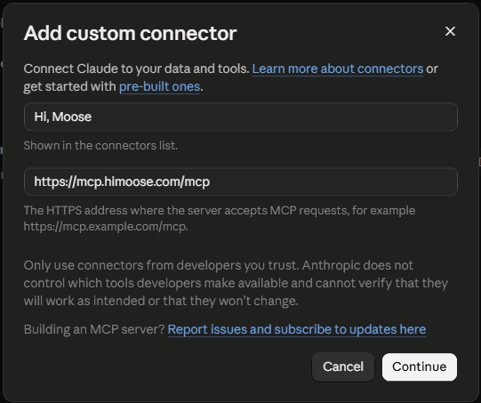

# Hi, Moose MCP

## What this helps you do

Overview, tool list and questions and answers: [himoose.com/hi-moose-mcp](https://himoose.com/hi-moose-mcp/). This page is the setup guide. The [tool reference](hi-moose-mcp/tools.md) describes every tool with what it takes and what comes back, and [troubleshooting](hi-moose-mcp/troubleshooting.md) covers the host device, waiting jobs and connection problems.

Hi, Moose MCP lets the AI apps you already work in use Hi, Moose. Add it as an MCP connector in Claude, ChatGPT, or any other app that supports MCP with sign-in, sign in with your Hi, Moose account, and ask for Hi, Moose work from inside that app. MCP (Model Context Protocol) is the standard these apps use to connect to outside tools.

The work runs on one of your own devices, the **host device**, where Hi, Moose stays open and signed in. Results come back to the app and are saved in your [Library](../library/overview.md).

## What a connected app can do

With the current tools, a connected app can:

- List your Hi, Moose projects
- List the briefs and drafts saved in your Library
- Check whether your site already covers a topic, with the pages that cover it and the date of the crawl it checked
- Create a content brief
- Write a draft from a brief
- Create a featured image
- Write FAQs with FAQPage schema for a saved draft or a page on your site
- Write key points for a saved draft or a page on your site
- Run an AEO audit on a live page, a saved draft or pasted content, with scores, issues and proposed fixes
- Plan internal links for a page, a saved draft or pasted content: which crawled pages it should link to, with the anchor text, and which pages should link back to it
- Answer "are we showing up in AI search for this topic" from the stored visibility results: per engine, whether your brand was mentioned or cited in the latest run and earlier, with a short excerpt from the latest answer
- Read the full text of one stored AI search answer
- List the opportunities worth working on, the same ranked rows as the Opportunities tab: the exact gap, the next step, the priority and the evidence, with the full detail for any one row on request
- Turn a live page, a saved draft or pasted text into a "listen to this article" audio episode, with the embeddable player snippet for the page; voices, length, language and the player look can be picked on the [audio settings page](https://himoose.com/hi-moose-mcp/audio/) and pasted back into the chat as one settings line
- Restyle the player of an existing audio episode without re-rendering the audio
- Pick up finished work

It cannot change settings or team members, and it cannot delete anything. More tools are on the way.

## Before you start

1. Open Hi, Moose on the device that should run the work, and sign in.
2. Go to **Settings → Hi, Moose MCP** and pick that device as the host device for the project. Only the account owner can choose the host device.
3. Copy the server address shown there:

```text
https://mcp.himoose.com/mcp
```

## Connect in Claude

In Claude.ai and the Claude desktop app:

1. Open **Settings → Connectors** (also reachable at claude.ai/customize/connectors).
2. Choose **Add custom connector**. Enter a name that will show in your connectors list, for example `Hi, Moose`, paste the server address, and click **Continue**.

    ```text
    https://mcp.himoose.com/mcp
    ```

    

3. Keep the settings Claude detects on the next screen: **Sign in now** under Authentication and **Use Claude's published identity** under OAuth client. Add no request headers. Under Advanced, leave Transport on automatic; the server uses streamable HTTP. Click **Add**.

4. Click **Connect** next to Hi, Moose MCP. A Hi, Moose page opens, shows what the app will be able to do, and asks you to sign in with your Hi, Moose account.
5. Start a new chat and ask, for example, "List my Hi, Moose projects".

On Team and Enterprise plans an owner adds the connector for the organization first, then each member connects.

In Claude Code:

```
claude mcp add --transport http himoose https://mcp.himoose.com/mcp
```

Then run `/mcp` inside Claude Code and follow the sign-in.

## Connect in ChatGPT

ChatGPT supports custom MCP servers on its paid plans. Menu names change from time to time; this is the current path.

1. Open **Settings → Apps** (called **Connectors** in some versions). On Business and Enterprise workspaces an owner may need to allow custom connectors first.
2. Choose **Add**, then **Create custom MCP server**. Older versions show **Create MCP app** instead and may need **Developer mode** turned on under Advanced settings first.
3. Paste the server address, choose **OAuth** as the authentication, and save.

    ```text
    https://mcp.himoose.com/mcp
    ```

4. Sign in with your Hi, Moose account on the page that opens.
5. In a chat, turn the connector on for that conversation and ask for Hi, Moose work.

## Other apps

Any app that can add a remote MCP server with OAuth sign-in works the same way: add the server address, sign in with your Hi, Moose account, and use it from there.

```text
https://mcp.himoose.com/mcp
```

## How a request runs

1. The app sends your request to Hi, Moose MCP.
2. Hi, Moose MCP hands it to the host device, which runs the work with the project's crawl, Brand Truth and research.
3. The result goes back to the app and is saved in your Library.

A brief, draft, image, FAQ set or key points list takes one to three minutes, an AEO audit two to four. A visibility question answers in a few seconds, and the opportunities list in under a minute. If the app says the work is still running, ask it to check again; it picks the result up when it is ready. If the host device is off or signed out, the app gets a message saying so.

Jobs run as the account signed in on the host device, so the Library they read and write is that account's Library. The **Recent agent jobs** table in Settings shows what was asked, by which app, and whether it finished.

## Disconnecting an app

Go to **Settings → Hi, Moose MCP**. The **Connected apps** table lists every app signed in to your account. **Revoke** signs that app out. It can take up to a minute to take effect, and the app can connect again later. Access also expires on its own after 30 days without use.
