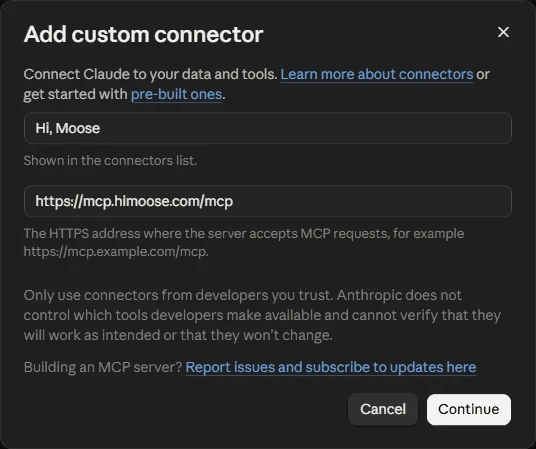

!!! note "Traduction automatique"
    Cette page a été traduite par IA. La version anglaise fait foi.

    [La lire en anglais](https://himoose.com/docs/integrations/hi-moose-mcp/)

# Hi, Moose MCP

## À quoi ça sert

Présentation, liste des outils et questions-réponses : [himoose.com/hi-moose-mcp](https://himoose.com/fr/hi-moose-mcp/). Cette page est le guide de configuration. La [référence des outils](hi-moose-mcp/tools.md) décrit chaque outil avec ce qu'il prend et ce qu'il renvoie, et le [dépannage](hi-moose-mcp/troubleshooting.md) couvre l'appareil hôte, les tâches en attente et les problèmes de connexion. [Sécurité et traitement des données](hi-moose-mcp/security.md) répond aux questions qu'une revue de sécurité pose avant qu'une équipe ne se connecte.

Hi, Moose MCP permet aux applications d'IA dans lesquelles vous travaillez déjà d'utiliser Hi, Moose. Ajoutez-le comme connecteur MCP dans Claude, ChatGPT ou toute autre application compatible MCP avec connexion, connectez-vous avec votre compte Hi, Moose et demandez du travail à Hi, Moose depuis cette application. MCP (Model Context Protocol) est le standard que ces applications utilisent pour se connecter à des outils externes.

Le travail s'exécute sur l'un de vos propres appareils, l'**appareil hôte**, où Hi, Moose reste ouvert et connecté. Les résultats reviennent dans l'application et sont enregistrés dans votre [Library](../library/overview.md).

## Ce qu'une application connectée peut faire

Avec les outils actuels, une application connectée peut :

- Lister vos projets Hi, Moose
- Lister les briefs et brouillons enregistrés dans votre Library
- Vérifier si votre site couvre déjà un sujet, avec les pages qui le couvrent et la date de l'exploration vérifiée
- Créer un brief de contenu
- Rédiger un brouillon à partir d'un brief
- Créer une image à la une
- Rédiger une FAQ avec le balisage FAQPage pour un brouillon enregistré ou une page de votre site
- Rédiger les points clés d'un brouillon enregistré ou d'une page de votre site
- Lancer un audit AEO d'une page en ligne, d'un brouillon enregistré ou d'un texte collé, avec scores, problèmes et corrections proposées
- Planifier les liens internes d'une page, d'un brouillon enregistré ou d'un texte collé : vers quelles pages explorées elle devrait pointer, avec le texte d'ancrage, et quelles pages devraient pointer vers elle
- Répondre à « apparaissons-nous dans la recherche IA pour ce sujet ? » à partir des résultats de visibilité enregistrés : par moteur, si votre marque a été mentionnée ou citée lors de la dernière exécution et avant, avec un court extrait de la dernière réponse
- Lire le texte complet d'une réponse de recherche IA enregistrée
- Lister les opportunités qui méritent du travail, les mêmes lignes classées que l'onglet Opportunités : l'écart exact, la prochaine étape, la priorité et les preuves, avec le détail complet d'une ligne sur demande
- Transformer une page en ligne, un brouillon enregistré ou un texte collé en épisode audio « écouter cet article », avec l'extrait du lecteur intégrable pour la page ; les voix, la durée, la langue et l'apparence du lecteur se choisissent sur la [page des réglages audio](https://himoose.com/fr/hi-moose-mcp/audio/) et se collent dans le chat sous la forme d'une seule ligne de réglages
- Restyler le lecteur d'un épisode audio existant sans régénérer l'audio
- Récupérer un travail terminé

Elle ne peut pas modifier les réglages ni les membres de l'équipe, et ne peut rien supprimer. D'autres outils arrivent.

## Avant de commencer

1. Ouvrez Hi, Moose sur l'appareil qui doit exécuter le travail et connectez-vous.
2. Allez dans **Paramètres → Hi, Moose MCP** et choisissez cet appareil comme appareil hôte du projet. Seul le propriétaire du compte peut choisir l'appareil hôte.
3. Copiez l'adresse du serveur affichée à cet endroit :

```text
https://mcp.himoose.com/mcp
```

## Connecter dans Claude

Cette section concerne Claude.ai dans le navigateur et l'application de bureau Claude. Claude Code, l'outil en terminal, a sa propre section plus bas.

1. Ouvrez **Paramètres → Connecteurs** (aussi accessible à claude.ai/customize/connectors).
2. Choisissez **Ajouter un connecteur personnalisé**. Saisissez un nom qui apparaîtra dans votre liste de connecteurs, par exemple `Hi, Moose`, collez l'adresse du serveur et cliquez sur **Continuer**.

    ```text
    https://mcp.himoose.com/mcp
    ```

    

3. Sur l'écran suivant, gardez les réglages détectés par Claude : **Se connecter maintenant** sous Authentification et **Utiliser l'identité publiée de Claude** sous Client OAuth. N'ajoutez aucun en-tête de requête. Dans Avancé, laissez le transport en automatique ; le serveur utilise Streamable HTTP. Cliquez sur **Ajouter**.

4. Cliquez sur **Connecter** à côté de Hi, Moose MCP. Une page Hi, Moose s'ouvre, montre ce que l'application pourra faire et vous demande de vous connecter avec votre compte Hi, Moose.
5. Démarrez une nouvelle conversation et demandez par exemple : « Liste mes projets Hi, Moose ».

Sur les offres Team et Enterprise, un propriétaire ajoute d'abord le connecteur pour l'organisation, puis chaque membre se connecte.

## Connecter dans Claude Code

Claude Code est l'outil en ligne de commande d'Anthropic pour les développeurs. Si vous travaillez plutôt dans Claude.ai ou l'application de bureau Claude, utilisez la section ci-dessus. Exécutez ceci dans un terminal :

```text
claude mcp add --transport http himoose https://mcp.himoose.com/mcp
```

Lancez ensuite `/mcp` dans Claude Code et suivez la connexion.

## Connecter dans ChatGPT

ChatGPT prend en charge les serveurs MCP personnalisés dans ses offres payantes. Les noms des menus changent de temps en temps ; voici le chemin actuel.

1. Ouvrez **Paramètres → Apps** (appelé **Connecteurs** dans certaines versions). Dans les espaces Business et Enterprise, un propriétaire doit parfois d'abord autoriser les connecteurs personnalisés.
2. Choisissez **Ajouter**, puis **Créer un serveur MCP personnalisé**. Les anciennes versions affichent **Créer une app MCP** et peuvent exiger d'abord le **Mode développeur** dans les réglages avancés.
3. Collez l'adresse du serveur, choisissez **OAuth** comme authentification et enregistrez.

    ```text
    https://mcp.himoose.com/mcp
    ```

4. Connectez-vous avec votre compte Hi, Moose sur la page qui s'ouvre.
5. Dans une conversation, activez le connecteur pour cette conversation et demandez du travail à Hi, Moose.

## Autres applications

Toute application capable d'ajouter un serveur MCP distant avec connexion OAuth fonctionne de la même façon : ajoutez l'adresse du serveur, connectez-vous avec votre compte Hi, Moose et utilisez-le depuis là.

```text
https://mcp.himoose.com/mcp
```

## Comment une demande s'exécute

1. L'application envoie votre demande à Hi, Moose MCP.
2. Hi, Moose MCP la transmet à l'appareil hôte, qui exécute le travail avec l'exploration, le Brand Truth et la recherche du projet.
3. Le résultat revient dans l'application et est enregistré dans votre Library.

Un brief, un brouillon, une image, une FAQ ou une liste de points clés prend une à trois minutes, un audit AEO deux à quatre. Une question de visibilité obtient sa réponse en quelques secondes, et la liste des opportunités en moins d'une minute. Si l'application dit que le travail est toujours en cours, demandez-lui de vérifier à nouveau ; elle récupère le résultat dès qu'il est prêt. Si l'appareil hôte est éteint ou déconnecté, l'application reçoit un message qui le signale.

Les tâches s'exécutent avec le compte connecté sur l'appareil hôte : la Library qu'elles lisent et écrivent est donc celle de ce compte. Le tableau **Tâches récentes des agents** dans les Paramètres montre ce qui a été demandé, par quelle application, et si c'est terminé.

## Déconnecter une application

Allez dans **Paramètres → Hi, Moose MCP**. Le tableau **Applications connectées** liste chaque application connectée à votre compte. **Révoquer** déconnecte cette application. Cela peut prendre jusqu'à une minute, et l'application pourra se reconnecter plus tard. L'accès expire aussi de lui-même après 30 jours sans utilisation.
