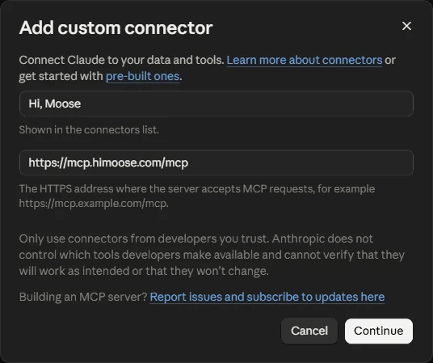

!!! note "Traduzione automatica"
    Questa pagina è stata tradotta da un'IA. La versione inglese è quella di riferimento.

    [Leggila in inglese](https://himoose.com/docs/integrations/hi-moose-mcp/)

# Hi, Moose MCP

## A cosa serve

Panoramica, elenco degli strumenti e domande e risposte: [himoose.com/hi-moose-mcp](https://himoose.com/it/hi-moose-mcp/). Questa pagina è la guida alla configurazione. Il [riferimento degli strumenti](hi-moose-mcp/tools.md) descrive ogni strumento con ciò che richiede e ciò che restituisce, e la [risoluzione dei problemi](hi-moose-mcp/troubleshooting.md) copre il dispositivo host, i lavori in attesa e i problemi di connessione. [Sicurezza e trattamento dei dati](hi-moose-mcp/security.md) risponde alle domande che una revisione di sicurezza pone prima che un team si colleghi.

Hi, Moose MCP permette alle app di IA in cui lavori già di usare Hi, Moose. Aggiungilo come connettore MCP in Claude, ChatGPT o qualsiasi altra app che supporta MCP con accesso, accedi con il tuo account Hi, Moose e chiedi lavoro a Hi, Moose da dentro quell'app. MCP (Model Context Protocol) è lo standard che queste app usano per collegarsi a strumenti esterni.

Il lavoro viene eseguito su uno dei tuoi dispositivi, il **dispositivo host**, dove Hi, Moose resta aperto e con l'accesso effettuato. I risultati tornano all'app e vengono salvati nella tua [Library](../library/overview.md).

## Cosa può fare un'app collegata

Con gli strumenti attuali, un'app collegata può:

- Elencare i tuoi progetti Hi, Moose
- Elencare i brief e le bozze salvati nella tua Library
- Verificare se il tuo sito copre già un argomento, con le pagine che lo coprono e la data della scansione verificata
- Creare un brief di contenuto
- Scrivere una bozza da un brief
- Aggiornare un contenuto che hai già: confrontare una pagina pubblicata, una bozza salvata o un testo incollato con i risultati di ricerca attuali e ottenere un brief di aggiornamento con le lacune e una bozza revisionata
- Creare un'immagine in evidenza, con il testo alternativo per la pagina
- Scrivere le FAQ con schema FAQPage per una bozza salvata o una pagina del tuo sito
- Scrivere i punti chiave di una bozza salvata o di una pagina del tuo sito
- Eseguire un audit AEO di una pagina pubblicata, una bozza salvata o un testo incollato, con punteggi, problemi e correzioni proposte
- Pianificare i link interni per una pagina, una bozza salvata o un testo incollato: a quali pagine scansionate dovrebbe rimandare, con il testo di ancoraggio, e quali pagine dovrebbero rimandare a essa
- Rispondere a "compariamo nella ricerca IA per questo argomento?" dai risultati di visibilità salvati: per motore, se il tuo brand è stato menzionato o citato nell'ultima esecuzione e in precedenza, con un breve estratto dell'ultima risposta
- Leggere il testo completo di una risposta salvata della ricerca IA
- Elencare le opportunità su cui vale la pena lavorare, le stesse righe in ordine di priorità della scheda Opportunità: la lacuna esatta, il passo successivo, la priorità e le prove, con il dettaglio completo di una riga su richiesta
- Trasformare una pagina pubblicata, una bozza salvata o un testo incollato in un episodio audio "ascolta questo articolo", con lo snippet del lettore incorporabile per la pagina; voci, durata, lingua e aspetto del lettore si scelgono nella [pagina delle impostazioni audio](https://himoose.com/it/hi-moose-mcp/audio/) e si incollano nella chat come un'unica riga di impostazioni
- Ridisegnare il lettore di un episodio audio esistente senza rigenerare l'audio
- Ritirare il lavoro pronto

Non può modificare impostazioni o membri del team e non può eliminare nulla. Altri strumenti sono in arrivo.

## Prima di iniziare

1. Apri Hi, Moose sul dispositivo che deve eseguire il lavoro ed effettua l'accesso.
2. Vai in **Impostazioni → Hi, Moose MCP** e scegli quel dispositivo come dispositivo host del progetto. Solo il proprietario dell'account può scegliere il dispositivo host.
3. Copia l'indirizzo del server mostrato lì:

```text
https://mcp.himoose.com/mcp
```

### Modello per le attività di scrittura

In **Impostazioni → Hi, Moose MCP** il proprietario dell'account sceglie anche il **modello per le attività di scrittura**: il modello che scrive i brief, le bozze, le FAQ, i punti chiave, gli aggiornamenti di contenuto e gli audit AEO richiesti da un'app MCP. Le immagini in evidenza usano il modello per le immagini. Il predefinito è Claude Sonnet 5.5. L'elenco corrisponde al selettore dei modelli della chat, con i modelli fuori dal tuo piano in grigio; se un modello salvato esce dal tuo piano in seguito, le attività di scrittura tornano al predefinito finché non ne scegli un altro. I membri del team vedono quale modello è in uso ma non possono cambiarlo.

## Collegare in Claude

Questa sezione riguarda Claude.ai nel browser e l'app desktop di Claude. Claude Code, lo strumento da terminale, ha una sezione a parte più sotto.

1. Apri **Impostazioni → Connettori** (raggiungibile anche da claude.ai/customize/connectors).
2. Scegli **Aggiungi connettore personalizzato**. Inserisci un nome che comparirà nel tuo elenco di connettori, per esempio `Hi, Moose`, incolla l'indirizzo del server e fai clic su **Continua**.

    ```text
    https://mcp.himoose.com/mcp
    ```

    

3. Nella schermata successiva mantieni le impostazioni rilevate da Claude: **Accedi ora** in Autenticazione e **Usa l'identità pubblicata di Claude** in Client OAuth. Non aggiungere header di richiesta. In Avanzate lascia il trasporto su automatico; il server usa Streamable HTTP. Fai clic su **Aggiungi**.

4. Fai clic su **Collega** accanto a Hi, Moose MCP. Si apre una pagina di Hi, Moose che mostra cosa potrà fare l'app e ti chiede di accedere con il tuo account Hi, Moose.
5. Avvia una nuova chat e chiedi, per esempio, «Elenca i miei progetti Hi, Moose».

Nei piani Team ed Enterprise, un owner aggiunge prima il connettore per l'organizzazione, poi ogni membro si collega.

## Collegare in Claude Code

Claude Code è lo strumento a riga di comando di Anthropic per sviluppatori. Se invece lavori in Claude.ai o nell'app desktop di Claude, usa la sezione sopra. Esegui questo in un terminale:

```text
claude mcp add --transport http himoose https://mcp.himoose.com/mcp
```

Poi esegui `/mcp` dentro Claude Code e segui l'accesso.

## Collegare in ChatGPT

ChatGPT supporta server MCP personalizzati nei piani a pagamento. I nomi dei menu cambiano di tanto in tanto; questo è il percorso attuale.

1. Apri **Impostazioni → App** (chiamato **Connettori** in alcune versioni). Negli spazi Business ed Enterprise, un owner potrebbe dover prima consentire i connettori personalizzati.
2. Scegli **Aggiungi** e poi **Crea server MCP personalizzato**. Le versioni più vecchie mostrano **Crea app MCP** e potrebbero richiedere prima la **Modalità sviluppatore** nelle impostazioni avanzate.
3. Incolla l'indirizzo del server, scegli **OAuth** come autenticazione e salva.

    ```text
    https://mcp.himoose.com/mcp
    ```

4. Accedi con il tuo account Hi, Moose nella pagina che si apre.
5. In una chat, attiva il connettore per quella conversazione e chiedi lavoro a Hi, Moose.

## Altre app

Qualsiasi app che può aggiungere un server MCP remoto con accesso OAuth funziona allo stesso modo: aggiungi l'indirizzo del server, accedi con il tuo account Hi, Moose e usalo da lì.

```text
https://mcp.himoose.com/mcp
```

## Skill per Claude e ChatGPT

Hi, Moose pubblica su GitHub skill gratuite e open source per l'ottimizzazione per i motori di risposta (AEO), chiamata anche GEO o AI SEO: [himoose/aeo-skills](https://github.com/himoose/aeo-skills) (licenza MIT). Una skill è una cartella di istruzioni che la tua app di IA segue per un tipo preciso di attività; queste usano il formato aperto [Agent Skills](https://agentskills.io).

Le skill sono tre, e tutte funzionano tramite Hi, Moose MCP:

- `ai-visibility` legge i risultati della ricerca IA che Hi, Moose ha già salvato. Non avvia mai nuovi controlli, non cambia le impostazioni e non pubblica nulla. Chiedi, per esempio:
    - «Crea la mia dashboard di visibilità nella ricerca IA.» È il risultato predefinito: una dashboard interattiva su una sola pagina HTML. Scegli 7, 30 o 90 giorni o le tue date, filtra per motore di IA, passa il mouse su un grafico per vedere i numeri, confronta il tuo brand monitorato con i concorrenti, guarda le risposte che hanno lasciato fuori il tuo brand e lavora su un elenco di attività con i pulsanti **Open in Hi, Moose**. I grafici si salvano in PNG, i numeri in CSV e la pagina in PDF.
    - «Scrivi il mio report di visibilità nella ricerca IA come testo per un'email.» Ricevi un breve report scritto.
    - «Su cosa dovrei lavorare questa settimana per comparire di più nella ricerca IA?» Ricevi le tue correzioni aperte come elenco di attività ordinato per priorità.
- `weekly-content-plan` legge il tuo elenco di Opportunità, tiene il lavoro di scrittura, lo raggruppa per tema, controlla il tuo sito e i tuoi brief salvati perché nulla venga scritto due volte, e sceglie i tre contenuti principali della settimana con le prove dietro a ciascuno. Su richiesta prepara un brief con ricerca per ciascuno. Chiedi «Cosa dovrei scrivere questa settimana?».
- `publish-ready-draft` porta un'opportunità o un argomento fino a un articolo finito: il brief, la bozza nella voce del tuo brand, l'audit AEO con le correzioni di testo applicate, i link interni dalla scansione del tuo sito, i punti chiave e le FAQ con markup schema, e l'immagine in evidenza. Chiedi «Scrivi l'articolo per l'opportunità 3 e rendilo pronto da pubblicare». Per una pagina che esiste già, aggiorna la pagina invece di scriverne una nuova.

Le skill funzionano con tutti i piani. I punteggi di sentiment, narrativa e accuratezza delle funzionalità fanno parte dei piani a pagamento; menzioni, citazioni, posizione e concorrenti funzionano con tutti i piani. I brief usano la ricerca con risultati di ricerca in tempo reale, che i piani gratuiti ricevono una volta al giorno. Come per ogni strumento di Hi, Moose MCP, tieni Hi, Moose aperto sul dispositivo host mentre fai le tue richieste.

### Aggiungere la skill in Claude.ai o nell'app desktop di Claude

1. Nella [pagina GitHub](https://github.com/himoose/aeo-skills), fai clic su **Code → Download ZIP** ed estrai il file.
2. Apri la cartella `skills` e comprimi in ZIP solo la cartella della skill che vuoi, per esempio `ai-visibility`, così da avere `ai-visibility.zip` con la cartella `ai-visibility` all'interno. Ripeti per ogni skill che vuoi.
3. In Claude, vai in **Customize → Skills**, fai clic su **+**, poi su **Create skill → Upload a skill**, e scegli lo ZIP.
4. Verifica che **code execution** sia attivo nelle impostazioni di Claude; le skill ne hanno bisogno.
5. Avvia una nuova chat, verifica che il connettore Hi, Moose sia attivo e fai la tua richiesta.

### Aggiungere la skill in Claude Code

Il repository è anche un plugin di Claude Code. Una sola installazione aggiunge tutte e tre le skill e il connettore Hi, Moose:

```text
/plugin marketplace add himoose/aeo-skills
/plugin install himoose@himoose
```

Poi esegui `/mcp`, scegli `plugin:himoose:himoose` e **Authenticate** per accedere. Se hai già aggiunto Hi, Moose con `claude mcp add` come mostrato sopra, gli stessi strumenti compaiono due volte; rimuovine uno in `/mcp`. Chiedi a parole tue, oppure esegui `/himoose:ai-visibility`, `/himoose:weekly-content-plan` o `/himoose:publish-ready-draft`.

### Aggiungere la skill in ChatGPT

Le skill sono disponibili solo su alcuni piani di ChatGPT; OpenAI indica gli spazi di lavoro Business, Enterprise, Healthcare ed Edu ([Skills in ChatGPT](https://help.openai.com/en/articles/20001066-skills-in-chatgpt)).

1. Collega Hi, Moose MCP in ChatGPT come descritto sopra.
2. Aggiungi come skill ogni cartella di skill che vuoi dal repository GitHub, per esempio `skills/ai-visibility`, seguendo le istruzioni di OpenAI per il tuo spazio di lavoro.
3. In una chat, digita `@` per scegliere la skill, oppure chiedi direttamente.

## Come viene eseguita una richiesta

1. L'app invia la tua richiesta a Hi, Moose MCP.
2. Hi, Moose MCP la passa al dispositivo host, che esegue il lavoro con la scansione, il Brand Truth e la ricerca del progetto.
3. Il risultato torna all'app e viene salvato nella tua Library.

Un brief, una bozza, un'immagine, una serie di FAQ o un elenco di punti chiave richiedono da uno a tre minuti; un audit AEO da due a quattro; un aggiornamento di contenuto da tre a sei. Una domanda di visibilità riceve risposta in pochi secondi e l'elenco delle opportunità in meno di un minuto. Se l'app dice che il lavoro è ancora in corso, chiedile di controllare di nuovo; ritira il risultato quando è pronto. Se il dispositivo host è spento o disconnesso, l'app riceve un messaggio che lo segnala.

I lavori vengono eseguiti con l'account connesso sul dispositivo host, quindi la Library che leggono e scrivono è quella di quell'account. La tabella **Lavori recenti degli agenti** nelle Impostazioni mostra cosa è stato chiesto, da quale app e se è terminato.

## Scollegare un'app

Vai in **Impostazioni → Hi, Moose MCP**. La tabella **App collegate** elenca ogni app con accesso al tuo account. **Revoca** disconnette quell'app. Può richiedere fino a un minuto, e l'app potrà collegarsi di nuovo più tardi. L'accesso scade anche da solo dopo 30 giorni senza utilizzo.
